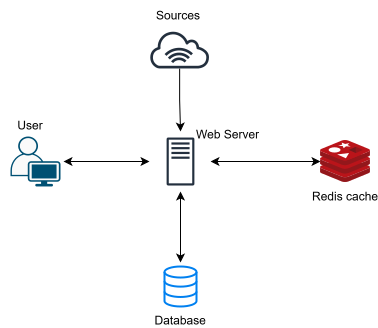

Either all of the sources can be refreshed at once or they can be selectively refreshed separately, based on how active the updates on the given source are. This can be automated at some point with metrics but for version 1 keep the updates constant for example every 3 hours. The metrics should still be saved at least with dummy data from the start.

For version 1 have a single backend server that handles the scraping on a schedule. Later improvement possibly separate scraper and web server

After fetching/refreshing the posts are saved to database (supabase). When a user fetches post for a specific tags after they have been refetched from sources, update the redis cache with the most up-to-date posts. Older posts are stored in the database.

Frontend and backend communication happens with HTTP requests. Frontend simply sends a GET with an array of specified tags and the backend or redis cache returns them. Posts should be ordered by descending date/time with the newest being the first.

If a source is down/unaccessible/has format changes it is simply skipped.

If the scraper finds the same url for two different tags, combine the tags under a single database entry.

